# ORBIT — Database Design

> Engine: **MySQL 8.0** (InnoDB, `utf8mb4_0900_ai_ci`) — see decision D-01 in [ARCHITECTURE.md](ARCHITECTURE.md#14-decision-log).
> Conventions: snake_case plural tables; `id BIGINT UNSIGNED` PKs; `organization_id` FK on every tenant table with `ON DELETE CASCADE`; `created_at/updated_at` everywhere; soft deletes only where users expect recovery (sources, dashboards, reports, metrics, alerts). Money is `DECIMAL(15,2)`; quantities `DECIMAL(12,3)`. Every fact table carries `business_date DATE` (org timezone) and lineage (`import_id`, `data_source_id`).

## 1. ERD

```mermaid
erDiagram
  users ||--o{ organization_user : "member of"
  organizations ||--o{ organization_user : has
  organizations ||--o{ invitations : issues
  users }o--|| organizations : "current_organization"

  organizations ||--o{ data_sources : owns
  data_sources ||--o| data_source_credentials : secret
  data_sources ||--o{ data_source_syncs : history
  data_sources ||--o{ imports : feeds
  imports ||--o{ import_mappings : maps
  imports ||--o{ import_errors : rejects

  organizations ||--o{ branches : has
  organizations ||--o{ departments : has
  organizations ||--o{ product_categories : has
  product_categories ||--o{ products : groups
  organizations ||--o{ expense_categories : has

  branches ||--o{ sales_transactions : records
  sales_transactions ||--|{ sales_transaction_items : contains
  products ||--o{ sales_transaction_items : sold_as
  branches ||--o{ expenses : incurs
  departments ||--o{ expenses : incurs
  expense_categories ||--o{ expenses : classifies
  products ||--o{ inventory_records : snapshot
  branches ||--o{ inventory_records : holds
  departments ||--o{ employees : employs
  branches ||--o{ employees : employs
  branches ||--o{ revenue_targets : targets

  organizations ||--o{ metrics : defines
  organizations ||--o{ dashboards : owns
  dashboards ||--o{ dashboard_widgets : contains
  dashboards ||--o{ dashboard_shares : shared_with
  users ||--o{ dashboard_shares : receives

  organizations ||--o{ reports : saves
  reports ||--o{ report_runs : executes
  reports ||--o| report_schedules : scheduled

  organizations ||--o{ alerts : monitors
  alerts ||--o{ alert_executions : evaluates
  organizations ||--o{ anomalies : detects
  organizations ||--o{ audit_logs : records
  organizations ||--o{ ai_conversations : holds
  ai_conversations ||--o{ ai_messages : contains
```

## 2. Identity & tenancy

**users** — `id, name, email (unique), email_verified_at, password, current_organization_id FK→organizations nullable ON DELETE SET NULL, theme enum(system,light,dark) default system, remember_token, two_factor_* (Fortify, nullable), timestamps`

**organizations** — `id, name, slug (unique, 3–48 chars), industry enum(retail,distribution,professional_services,manufacturing,hospitality,technology,other), size enum(1_10,11_50,51_200,201_1000,1000_plus), timezone default 'Asia/Karachi', currency char(3) default 'PKR', logo_path nullable, fiscal_year_start_month tinyint default 7, onboarded_at nullable, timestamps, deleted_at`

**organization_user** — `id, organization_id, user_id, role enum(owner,admin,analyst,viewer), joined_at, timestamps`
- UNIQUE `(organization_id, user_id)`; INDEX `(user_id)`

**invitations** — `id, organization_id, email, role, token_hash (char 64, unique), invited_by FK→users, expires_at, accepted_at nullable, timestamps`
- INDEX `(organization_id, email)`; only the SHA-256 of the token is stored.

Standard Laravel tables: `password_reset_tokens`, `sessions`, `cache`, `cache_locks`, `jobs`, `job_batches`, `failed_jobs`.

> Evaluated and **not** created: `roles`, `permissions` (D-03 — role enum on the pivot + permission matrix in code).

## 3. Data sources

**data_sources** — `id, organization_id, name, type enum(csv,xlsx,mysql,postgres,rest), description nullable, status enum(active,error,disabled,pending), config JSON (non-secret: host, port, database, table, records_path, …), last_synced_at nullable, last_error text nullable, created_by FK→users, timestamps, deleted_at`
- UNIQUE `(organization_id, name)`; INDEX `(organization_id, status)`

**data_source_credentials** — `id, data_source_id (unique) FK cascade, secret TEXT (Laravel encrypted JSON: password / token / headers), rotated_at, timestamps`
- Separate table so a `DataSource` can never accidentally serialize secrets; model also lists `secret` in `$hidden`.

**data_source_syncs** — `id, organization_id, data_source_id, import_id nullable, trigger enum(manual,schedule), status, rows_read, started_at, finished_at, error text nullable, timestamps`

## 4. Imports

**imports** — `id, organization_id, data_source_id nullable, dataset_type enum(sales,expenses,products,inventory,employees,branches,departments), original_filename, disk, path, size_bytes, checksum_sha256, status enum(pending,processing,completed,completed_with_errors,failed), headers JSON, options JSON (date_format, delimiter, sheet), total_rows nullable, processed_rows default 0, imported_rows default 0, failed_rows default 0, duplicate_rows default 0, failure_reason text nullable, created_by, started_at, completed_at, timestamps`
- INDEX `(organization_id, created_at)`, `(organization_id, status)`

**import_mappings** — `id, import_id, source_column, target_field, transform nullable, timestamps`
- UNIQUE `(import_id, target_field)`

**import_errors** — `id, import_id, row_number, field nullable, code (required|invalid_date|invalid_number|unknown_reference|duplicate|...), message, raw JSON, created_at`
- INDEX `(import_id, row_number)`

## 5. Business datasets (normalized analytics model)

Dimensions:

| Table | Columns | Keys |
|---|---|---|
| **branches** | `id, organization_id, code, name, city, opened_on nullable, is_active, import_id nullable, timestamps` | UNIQUE `(organization_id, code)` |
| **departments** | `id, organization_id, code, name, timestamps` | UNIQUE `(organization_id, code)` |
| **product_categories** | `id, organization_id, name, timestamps` | UNIQUE `(organization_id, name)` |
| **products** | `id, organization_id, product_category_id, sku, name, unit_price, unit_cost, is_active, import_id, timestamps` | UNIQUE `(organization_id, sku)`; INDEX `(organization_id, product_category_id)` |
| **expense_categories** | `id, organization_id, name, kind enum(operating,cost_of_sales,capital) default operating, timestamps` | UNIQUE `(organization_id, name)` |

Facts:

**sales_transactions** (order header) — `id, organization_id, branch_id, reference, occurred_at DATETIME (UTC), business_date DATE, status enum(completed,refunded,cancelled,pending), channel enum(store,online,wholesale), customer_segment nullable, items_count, gross_amount, discount_amount, net_amount, import_id nullable, data_source_id nullable, timestamps`
- UNIQUE `(organization_id, reference)`
- INDEX `(organization_id, business_date, status)`, `(organization_id, branch_id, business_date)`

**sales_transaction_items** — `id, organization_id, sales_transaction_id FK cascade, product_id, quantity, unit_price, unit_cost (snapshot at sale), discount_amount, net_amount, business_date (denormalized), branch_id (denormalized), natural_key_hash char(40), import_id nullable, data_source_id nullable`
- UNIQUE `(organization_id, natural_key_hash)` — duplicate defense
- INDEX `(organization_id, business_date, product_id)`, `(organization_id, branch_id, business_date)`
- `business_date`/`branch_id` are denormalized deliberately: product/category aggregates are the hottest queries and avoid a join to the header (consistency maintained by the importer/seeder; header status drives revenue, so status is joined — see engine).

**expenses** — `id, organization_id, branch_id nullable, department_id nullable, expense_category_id, reference nullable, vendor nullable, description nullable, amount, business_date, natural_key_hash, import_id, data_source_id, timestamps`
- UNIQUE `(organization_id, natural_key_hash)`; INDEX `(organization_id, business_date)`, `(organization_id, expense_category_id, business_date)`

**inventory_records** (periodic snapshots) — `id, organization_id, product_id, branch_id, recorded_on DATE, quantity_on_hand, reorder_level, unit_cost, import_id, data_source_id, timestamps`
- UNIQUE `(organization_id, product_id, branch_id, recorded_on)`

**employees** — `id, organization_id, employee_code, full_name, branch_id nullable, department_id, job_title, employment_type enum(full_time,part_time,contract), hired_on, terminated_on nullable, monthly_salary nullable, import_id, timestamps, deleted_at`
- UNIQUE `(organization_id, employee_code)`; INDEX `(organization_id, department_id)`, `(organization_id, hired_on)`

**revenue_targets** — `id, organization_id, branch_id nullable (null = org-wide), month DATE (first day), amount, timestamps`
- UNIQUE `(organization_id, branch_id, month)`

## 6. Analytics & dashboards

**metrics** (custom metrics; base metrics are code) — `id, organization_id, key (slug), name, description nullable, formula, dependencies JSON, format enum(currency,number,percent), decimals tinyint, polarity enum(up_good,up_bad,neutral), visibility enum(private,organization), created_by, timestamps, deleted_at`
- UNIQUE `(organization_id, key)`

**dashboards** — `id, organization_id, owner_id FK→users, name, description nullable, visibility enum(private,organization,shared), default_filters JSON nullable, is_default bool, timestamps, deleted_at`
- INDEX `(organization_id, visibility)`

**dashboard_widgets** — `id, dashboard_id FK cascade, type enum(kpi,line,bar,area,pie,donut,table,ranked_list), title, config JSON, x, y, w, h (unsigned small ints), timestamps`
- `config` schema (validated server-side): `{metric, metrics?, dimension?, date_range: {mode: inherit|fixed, preset?, from?, to?}, filters: {branch_ids?, category_ids?, department_ids?}, comparison: bool, limit?, options: {stacked?, show_legend?, value_format?}}`
- JSON is appropriate here: widget configuration is presentation metadata, not business data.

**dashboard_shares** — `id, dashboard_id, user_id, permission enum(view,edit), timestamps` — UNIQUE `(dashboard_id, user_id)`

## 7. Reporting

**reports** — `id, organization_id, name, type enum(sales_performance,revenue_analysis,expense_analysis,branch_comparison,product_performance,inventory_summary,workforce_overview), parameters JSON {date_range, filters, columns[], sort:{column,direction}}, created_by, timestamps, deleted_at`

**report_runs** — `id, organization_id, report_id nullable (ad-hoc runs allowed), type, parameters JSON (snapshot), format enum(csv,xlsx,pdf), status enum(queued,running,completed,failed), row_count, file_disk, file_path, error nullable, requested_by, started_at, completed_at, timestamps`

**report_schedules** — `id, organization_id, report_id unique, frequency enum(daily,weekly,monthly), run_at_time TIME, day_of_week nullable, day_of_month nullable, format, recipients JSON (user ids), next_run_at, is_active, timestamps`

## 8. Monitoring

**alerts** — `id, organization_id, name, kind enum(metric,import_failed,source_stale), metric_key nullable, condition enum(below,above,drops_by_pct,rises_by_pct) nullable, threshold DECIMAL(15,4) nullable, window enum(day,week,month) nullable, filters JSON nullable, frequency enum(hourly,daily,weekly), recipients JSON (user ids), is_active, state enum(ok,triggered) default ok, last_evaluated_at, last_triggered_at, next_evaluation_at, created_by, timestamps, deleted_at`
- INDEX `(is_active, next_evaluation_at)` (scheduler scan, cross-tenant by design inside `runAs`)

**alert_executions** — `id, organization_id, alert_id, evaluated_at, observed_value nullable, threshold nullable, outcome enum(ok,triggered,resolved,error), notified bool, details JSON, created_at` — INDEX `(alert_id, evaluated_at)`

**anomalies** — `id, organization_id, metric_key, business_date, actual, expected, lower_bound, upper_bound, z_score, severity enum(warning,critical), explanation, detected_at, timestamps` — UNIQUE `(organization_id, metric_key, business_date)`

**notifications** (Laravel) + `organization_id` nullable indexed column — INDEX `(notifiable_type, notifiable_id, organization_id, read_at)`

**audit_logs** — `id, organization_id nullable (null for global events e.g. failed login), user_id nullable, action (e.g. data_source.updated), subject_type nullable, subject_id nullable, metadata JSON (redacted), ip_address, user_agent, created_at` — INDEX `(organization_id, created_at)`, `(organization_id, action)`. Append-only (no update/delete routes).

## 9. AI

**ai_conversations** — `id, organization_id, user_id, title, timestamps`
**ai_messages** — `id, ai_conversation_id, role enum(user,assistant), content TEXT, tool_calls JSON nullable, evidence JSON nullable, model nullable, input_tokens, output_tokens, created_at`

## 10. Integrity rules not expressible as FKs
- Fact rows' `branch_id`, `product_id`, etc. must belong to the same organization — guaranteed by `ReferenceResolver` (org-scoped lookup maps) and asserted in tests.
- `sales_transactions.net_amount` = Σ items `net_amount` — recomputed at import finalize; seeder writes both consistently; a `orbit:verify-integrity` command checks it.
- At least one `owner` per organization — enforced in `MembershipService` inside a transaction with `lockForUpdate`.
